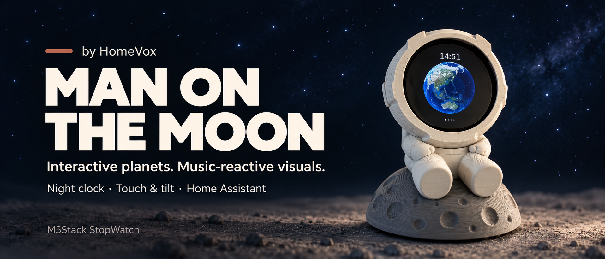
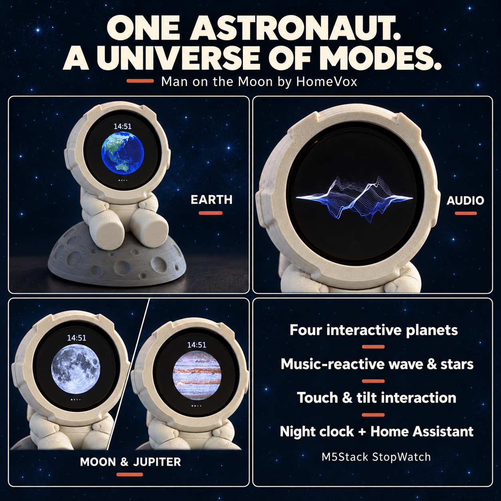

<div align="center">

# 🌍 Man on the Moon by HomeVox

**A tiny window into space.**



<p><a href="#explore-the-visor">Features</a> &nbsp; · &nbsp; <a href="#build-and-flash">Setup</a> &nbsp; · &nbsp; <a href="#home-assistant">Home Assistant</a></p>

</div>

---

An astronaut sits on the moon, with a small round window into another world. Earth turns inside his visor. Touch it and give it a spin. Press a button to visit the Moon, Mars or Jupiter, or let a sound wave and a sky full of stars move with your music.

**Man on the Moon** combines a printed astronaut enclosure with firmware for the **M5Stack StopWatch**. A quiet amber night clock and Home Assistant controls make it part of your room as well as your desk.

<a id="explore-the-visor"></a>

## ✨ Features

| Mode | What you can do |
|---|---|
| Earth, Moon, Mars and Jupiter | Explore four textured globes, spin them with a finger and tilt the device to make them roll |
| Audio | Watch a soft wave in Earth blue, moon silver and warm sunlight respond to sound |
| Starry sky | See stars and a faint Milky Way react to music; stir the stars with your finger |
| Night clock | Tap to see Earth's city lights and the time in warm amber, then let the screen go dark again |



The globes stay level as you tilt the StopWatch. The starry sky includes subtle shooting stars; a clap-like sound can trigger an extra one. Music response comes from the built-in microphone, so there is no audio cable to connect.

### Buttons and touch

- **Button A:** move through Earth → Moon → Mars → Jupiter.
- **Button B:** switch between Audio and Starry sky. When moving between the planet and audio groups, the device remembers the last mode used in each group during the running session.
- **Swipe a globe:** spin it and let its movement settle.
- **Drag through the stars:** stir them, then watch them drift back.

### A quiet night clock

During the selected night hours, the screen stays dark. A tap or button press shows Earth at night and the time for **30 seconds**, in warm amber at **10% brightness**. A Home Assistant Night mode switch activates the same behavior whenever you want it.

The timed night clock uses network time. The default window is **22:00–07:00**. If time has not synchronized after starting in an audio mode, open a planet mode to start clock synchronization.

<a id="home-assistant"></a>

## 🏠 Home Assistant

Configure your MQTT broker details and the device announces itself through MQTT discovery as **Stopwatch**.

| Control | Purpose |
|---|---|
| Modus | Audio, Starry sky, Earth, Moon, Mars or Jupiter |
| Klok / Helderheid | Clock visibility and display brightness |
| Microfoon | Microphone on/off |
| Audio / Sterrenhemel settings | Separate response strength and sensitivity |
| Melkweg | Strength of the Milky Way's music response |
| Nachtklok / van / tot | Scheduled night-clock settings |
| Nachtstand | Night mode immediately |
| Automatisch slapen / Slapen | Automatic sleep or sleep now |

The current entity labels are Dutch. Settings are stored on the device. Availability is published on `stopwatch/status`.

With automatic sleep enabled, the StopWatch enters deep sleep after two minutes without interaction, except while USB-powered or in night mode. Press A or B to wake it. Deep sleep disconnects the network until it wakes.

<a id="print-the-astronaut"></a>

## 🖨️ Printing & assembly

The enclosure consists of an astronaut, visor ring, two button pieces and a moon base. The USB-C cable passes through the body and base and exits underneath at the rear.

Use PLA, a **0.4 mm nozzle**, **0.2 mm layers**, **three walls** and **15% infill** as starting settings.

| Part | Orientation and support |
|---|---|
| Astronaut | Supplied flat underside; use a brim and support in the helmet opening |
| Ring | Front face down; no support |
| Two buttons | Rear face down; no support, print slowly |
| Moon | Flat underside down; no support |

The two 3MF files in the v22 print bundle contain the arranged model geometry. Set your printer, material and support settings in the slicer.

Use a **straight USB-C plug** with a housing no larger than **13.5 × 8.8 mm** and **21 mm long**. Follow the illustrated assembly manual in the print bundle: route the cable, fit the astronaut to the moon, insert the StopWatch bottom-first, place the two buttons with their tabs toward the visor and press on the ring.

---

<a id="build-and-flash"></a>

## 🔧 Build & flash

Firmware target: **ESP32-S3 / M5Stack StopWatch**, built with **ESP-IDF 5.5.x**.

1. Open an ESP-IDF terminal and change to `firmware/`.
2. Fetch the pinned components:

   ```sh
   python fetch_repos.py
   ```

3. Copy `main/secrets.example.h` to `main/secrets.h`, and `main/mqtt_secrets.example.h` to `main/mqtt_secrets.h`.
4. Enter Wi-Fi and MQTT details in the local files. Use a non-empty MQTT username for the MQTT discovery path. The standard animation mode does not require a Home Assistant access token.
5. Connect the StopWatch by USB, then build and flash:

   ```sh
   idf.py build
   idf.py -p <PORT> flash
   ```

6. With the MQTT integration configured in Home Assistant, look for **Stopwatch** under MQTT devices.

If a normal flash/reset leaves the screen black, run this from `firmware/build/`, replacing `<PORT>` with the serial port:

```sh
python -m esptool --chip esp32s3 -p <PORT> -b 921600 --before default_reset --after watchdog_reset write_flash "@flash_args"
```

Keep real credentials in the ignored local secret files.

<a id="inside-the-firmware"></a>

## 📁 Inside the firmware

- `firmware/main/apps/app_jarvis/view/jarvis_view.cpp`: frame loop and audio wave.
- `view/jarvis_earth.cpp`: globes, maps and clock rendering.
- `view/jarvis_sky.cpp`: star field, music response, touch and shooting stars.
- `ha/ha_ctl.cpp`: MQTT discovery, controls and saved settings.
- `app_jarvis.cpp`: buttons, touch, night mode and sleep.

The visuals run locally on the StopWatch; Home Assistant is only used for the controls.

<a id="credits"></a>

## 🙏 Credits

The firmware builds on M5Stack's StopWatch demo; see `firmware/LICENSE` and the licences of its components. Map credits: NASA Blue Marble and Black Marble, NASA LRO/LROC CGI Moon Kit, NASA/USGS Viking Mars imagery and NASA/JPL/Space Science Institute Cassini Jupiter imagery. NASA and M5Stack do not endorse this project.

## 📄 License

HomeVox code and documentation: MIT, see `LICENSE`. The firmware base keeps M5Stack's MIT licence in `firmware/LICENSE`; components keep their own licences.

**Man on the Moon by HomeVox. Made for anyone who likes looking up.**
